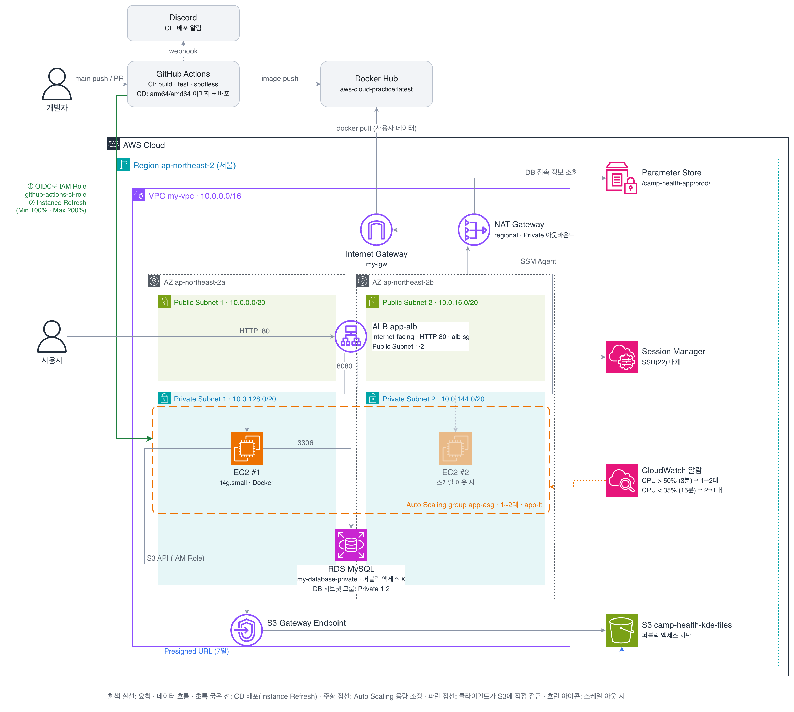

<a id="team-member-service"></a>
<div align="center">

# 클라우드_아키텍처 설계 & 배포


[](https://github.com/euneuneun/aws-cloud-practice/actions/workflows/deploy.yml)

</div>


## 문서

* 📐[SUBMISSION.md](docs/submission/SUBMISSION.md) — LV 0 ~ 6 과제 제출물, 스크린샷
* 🔍[INFRA.md](docs/INFRA.md) — 인프라 상세
* 📝[DESIGN.md](docs/DESIGN.md) — API 명세, 테이블 설계, 프로젝트 구조

## 아키텍처




## 빠른 시작

**요구사항**: Java 17

```bash
git clone https://github.com/euneuneun/aws-cloud-practice.git && cd aws-cloud-practice
./gradlew bootRun --args='--spring.profiles.active=local'
```

```bash
curl -X POST localhost:8080/api/members \
  -H "Content-Type: application/json" \
  -d '{"memberName":"홍길동","memberAge":27,"memberMbti":"ENFP"}'

curl localhost:8080/actuator/health   # {"status":"UP"}
```

- H2 콘솔: `http://localhost:8080/h2-console` (JDBC URL `jdbc:h2:mem:testdb`)

<details>
<summary><b>운영(prod) 환경으로 실행하기</b></summary>

| 프로필 | DB | Parameter Store | DDL |
|---|---|---|---|
| `local` | H2 인메모리 (MySQL 모드) | 사용 안 함 | `create-drop` |
| `prod` | MySQL (RDS) | 사용 | `update` |

prod는 DB 접속 정보를 **실행 시점에 Parameter Store(`/camp-health-app/prod/`)에서 주입**받으므로 아래가 준비되어 있어야 합니다.

- EC2에 Parameter Store · S3 권한이 있는 IAM Role 연결
- Parameter Store에 `DB_URL`, `DB_USERNAME`, `DB_PASSWORD`, `TEAM_NAME` 등록 ([상세](docs/INFRA.md#parameter-store))

```bash
java -jar build/libs/aws-cloud-practice-0.0.1-SNAPSHOT.jar --spring.profiles.active=prod
```
</details>

<p align="right"><a href="#team-member-service">맨 위로</a></p>
