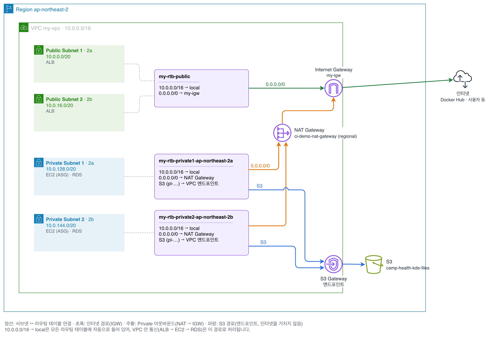
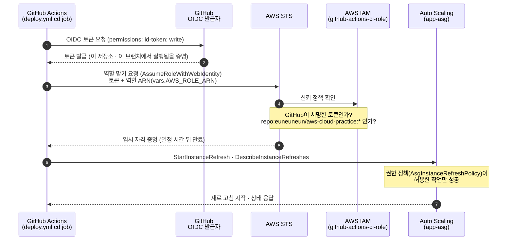
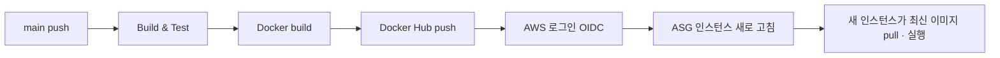
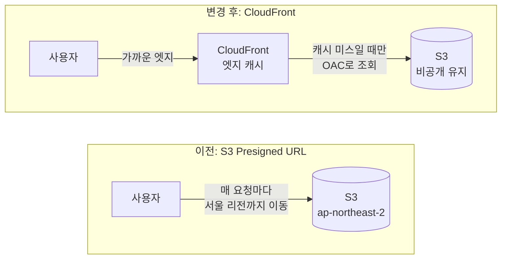

# 인프라 구성 상세

[← README로 돌아가기](../README.md)

## 목차
- [VPC · Subnet](#vpc--subnet)
- [보안 그룹](#보안-그룹)
- [IAM](#iam)
- [Parameter Store](#parameter-store)
- [S3](#s3)
- [Docker](#docker)
- [CI/CD](#cicd)
- [ALB · ASG · 도메인](#alb--asg--도메인)
- [CloudFront](#cloudfront)

리전: `ap-northeast-2` (서울)

## VPC · Subnet



| 리소스 | 이름 | CIDR | AZ | 라우팅 |
|---|---|---|---|---|
| VPC | `my-vpc` | `10.0.0.0/16` | | |
| Public Subnet 1 | `my-subnet-public1-ap-northeast-2a` | `10.0.0.0/20` | 2a | `my-rtb-public`: `0.0.0.0/0 → IGW(my-igw)` |
| Public Subnet 2 | `my-subnet-public2-ap-northeast-2b` | `10.0.16.0/20` | 2b | `my-rtb-public`: `0.0.0.0/0 → IGW(my-igw)` |
| Private Subnet 1 | `my-subnet-private1-ap-northeast-2a` | `10.0.128.0/20` | 2a | `my-rtb-private1-ap-northeast-2a`: `0.0.0.0/0 → NAT`, S3 → VPC 엔드포인트 |
| Private Subnet 2 | `my-subnet-private2-ap-northeast-2b` | `10.0.144.0/20` | 2b | `my-rtb-private2-ap-northeast-2b`: `0.0.0.0/0 → NAT`, S3 → VPC 엔드포인트 |

### 리소스 배치

> 요청 흐름과 CI/CD까지 포함한 전체 구조는 [README의 아키텍처 그림](../README.md#architecture)을 참고한다.

| 리소스 | 이름 | 위치 | 외부 접근 |
|---|---|---|---|
| ALB | `app-alb` (internet-facing) | Public Subnet 1·2 | 외부 요청을 받는 유일한 입구 (HTTPS 443, HTTP 80은 HTTPS로 리다이렉트) |
| EC2 | ASG `app-asg`가 관리 (t4g.small, 1~2대) | Private Subnet 1·2 | 공인 IP가 없어 로컬에서 직접 접속할 수 없음 |
| RDS | `my-database-private` (MySQL, db.t4g.micro) | DB 서브넷 그룹 `my-vpc-private-subnet-group` (Private 1·2) | 퍼블릭 액세스가 `아니요`라 엔드포인트가 사설 IP(`10.0.x.x`)로만 조회됨 |
| NAT Gateway | `ci-demo-nat-gateway` (regional) | | Private 서브넷에서 외부로 나가는 통신(Docker Hub, SSM, Parameter Store) 전용 |
| CloudFront | `camp-health-images` | 글로벌 엣지 | 프로필 이미지 조회의 유일한 입구 (HTTPS) |
| S3 | `camp-health-kde-files` | 리전 서비스 (VPC 밖) | 퍼블릭 액세스 차단 · S3 URL 직접 요청은 403, CloudFront(OAC)만 읽기 가능 |

- EC2 접속은 SSH(22) 대신 Session Manager를 사용한다. SSM 에이전트가 EC2 안에서 바깥으로 연결을 열기 때문에 인바운드 포트와 공인 IP가 필요하지 않다.
- 기존 Public Subnet의 EC2 · RDS는 AMI · 스냅샷(`my-database-before-private`)으로 복제해 Private Subnet에 새로 구성한 뒤 삭제했다.

## 보안 그룹


```
[API]    인터넷 ──443(80→443)──▶ ALB ──8080──▶ EC2 ──3306──▶ RDS
              누구나        ALB만          EC2만

[이미지] 인터넷 ──443──▶ CloudFront ──OAC──▶ S3 (비공개)
                                  이 배포만
```

- 이미지 경로는 VPC 밖이라 보안 그룹이 아닌 S3 버킷 정책(OAC)으로 접근을 제한한다. ([CloudFront](#cloudfront) 참고).

| 보안 그룹 | 인바운드 포트 | 소스 | 이유 |
|---|---|---|---|
| ALB (`alb-sg`) | 80 · 443 | `0.0.0.0/0` | 인터넷에서 오는 요청을 받는 입구 (80은 HTTPS 리다이렉트용) |
| EC2 (`test-ec2-sg`) | 8080 | ALB 보안 그룹 ID (`alb-sg`) | 보안 그룹 체이닝: ALB가 전달한 요청만 허용 |
| RDS (`test-rds-sg`) | 3306 | EC2 보안 그룹 ID (`test-ec2-sg`) | 보안 그룹 체이닝: EC2에서 오는 연결만 허용 |

- 소스를 IP가 아닌 보안 그룹으로 지정해, ALB · EC2의 IP가 바뀌거나 늘어나도 규칙을 고칠 필요가 없다.
- 아웃바운드는 ALB · EC2가 기본값(`0.0.0.0/0`)이고, RDS는 규칙이 없다. RDS는 먼저 연결을 시작하지 않고, EC2 요청에 대한 응답은 상태 저장 특성으로 자동 허용된다.
- EC2의 22번(SSH) 포트는 Session Manager 접속 방식으로 전환하며 폐쇄했고, EC2가 직접 트래픽을 수신할 일이 없는 3306과 80번 포트 역시 차단하여 불필요한 포트 노출을 최소화했다.

## IAM

| Role | 사용 주체 (신뢰 정책) | 연결한 정책 (권한 정책) |
|---|---|---|
| `instanceRole` | EC2 (ASG 인스턴스) | 아래 참고 |
| `github-actions-ci-role` | GitHub Actions (OIDC, `repo:euneuneun/aws-cloud-practice:*`만 허용) | 인라인 `AsgInstanceRefreshPolicy`: `app-asg`에 대한 `StartInstanceRefresh` · `DescribeInstanceRefreshes` |

- **`instanceRole`**: EC2에 역할을 연결하면 Spring Cloud AWS(SDK)가 임시 자격 증명을 자동으로 찾아 쓰므로, 코드나 설정 파일에 액세스 키를 넣지 않는다.
- **`github-actions-ci-role`**: OIDC로 로그인해 GitHub Secrets에 AWS 액세스 키를 저장하지 않는다. 신뢰 정책의 저장소 조건 때문에 다른 저장소는 이 역할을 맡을 수 없다.

**GitHub Actions OIDC 로그인 흐름**



- 1~5는 `aws-actions/configure-aws-credentials` 액션이 자동으로 처리하고, 6부터 배포 스크립트가 받은 임시 자격 증명으로 AWS를 호출한다.
- 신뢰 정책(4)은 누가 역할을 맡을 수 있는지, 권한 정책(6)은 맡은 뒤 무엇을 할 수 있는지를 검사한다.

`instanceRole`은 애플리케이션 코드가 쓰는 아래 AWS 작업을 허용한다.

| 서비스 | 작업 | 사용 위치 |
|---|---|---|
| SSM Parameter Store | 경로(`/camp-health-app/prod/`) 아래 파라미터 조회 | `spring.config.import` (prod) |
| S3 | `PutObject` | 프로필 이미지 업로드 |
| S3 | `DeleteObject` | 새 이미지 업로드 시 기존 이미지 삭제 |
| S3 | `GetObject` | 사용 안 함 (CloudFront 전환 후 이미지 조회는 CloudFront가 OAC로 처리) |

<details>
<summary>연결한 정책</summary>

AWS 관리형: `AmazonSSMManagedInstanceCore`(Session Manager), `AmazonSSMReadOnlyAccess`(Parameter Store 조회), `CloudWatchAgentServerPolicy`

고객 관리형 `S3CampHealthPolicy`:

```json
{
  "Version": "2012-10-17",
  "Statement": [
    {
      "Effect": "Allow",
      "Action": ["s3:PutObject", "s3:GetObject", "s3:DeleteObject"],
      "Resource": "arn:aws:s3:::camp-health-kde-files/uploads/*"
    }
  ]
}
```

---

</details>

## Parameter Store

경로: `/camp-health-app/prod/`

| Key | 용도 | 타입 |
|---|---|---|
| `DB_URL` | RDS 접속 URL → `spring.datasource.url` | `String` |
| `DB_USERNAME` | DB 사용자 → `spring.datasource.username` | `String` |
| `DB_PASSWORD` | DB 비밀번호 → `spring.datasource.password` | `String` |
| `TEAM_NAME` | 확인용 파라미터 → `/actuator/info` | `String` |

```yaml
# application-prod.yaml
spring:
  datasource:
    url: ${DB_URL}
    username: ${DB_USERNAME}
    password: ${DB_PASSWORD}
  config:
    import:
      - aws-parameterstore:/camp-health-app/prod/
  cloud:
    aws:
      parameterstore:
        enabled: true

management:
  info:
    env:
      enabled: true   # info.* 속성을 /actuator/info에 노출

info:
  app:
    message: ${TEAM_NAME}
```

`/actuator/info` 응답 형태:
```json
{ "app": { "message": "{TEAM_NAME 값}" } }
```

> local 프로필에서는 `spring.cloud.aws.parameterstore.enabled: false`로 Parameter Store를 사용하지 않는다.

## S3

| 항목 | 설정 |
|---|---|
| 버킷 | `camp-health-kde-files` |
| 모든 퍼블릭 액세스 차단 | ON |
| 객체 key 규칙 | `uploads/members/{UUID}.{확장자}` |
| 업로드 제한 | PNG · JPEG · WebP, 최대 10MB |
| 조회 방식 | DB에 저장한 key로 CloudFront URL 생성 ([CloudFront](#cloudfront) 참고) |

## Docker

```dockerfile
FROM amazoncorretto:17-al2023-headless
WORKDIR /app
COPY build/libs/*.jar app.jar
EXPOSE 8080
ENTRYPOINT ["java", "-jar", "app.jar"]
```

- 빌드된 jar를 복사해 실행하는 구조이므로, 이미지 빌드 전에 `./gradlew bootJar`가 먼저 실행되어야 한다.

## CI/CD



- EC2가 Private Subnet에 있어 SSH로 접속할 수 없으므로, ASG에 인스턴스 새로 고침을 요청해 서버를 교체하는 방식으로 배포한다.
- 새 인스턴스는 시작 템플릿(EC2를 만들 때 쓰는 설계도)의 사용자 데이터로 Docker Hub의 최신 이미지를 받아 실행한다.
- `MinHealthyPercentage 100` · `MaxHealthyPercentage 200`: 새 인스턴스가 healthy가 된 뒤 기존 인스턴스를 종료해 배포 중에도 서비스가 끊기지 않는다.
- 교체가 끝날 때까지 30초마다 상태를 확인하고(최대 20분), 결과를 Discord로 알린다.
- `concurrency: deploy`로 배포는 한 번에 하나씩만 실행된다. 새로 고침이 진행 중일 때 또 merge되면, 다음 배포는 취소되지 않고 앞 배포가 끝날 때까지 기다린다. (동시에 요청하면 `InstanceRefreshInProgress` 오류로 실패하기 때문)

| GitHub Secret / Variable | 용도 |
|---|---|
| `DOCKERHUB_USERNAME` (Variable) | Docker Hub 계정 · 이미지 이름 |
| `DOCKERHUB_TOKEN` | Docker Hub 로그인 |
| `AWS_ROLE_ARN` · `AWS_REGION` (Variable) | OIDC로 맡을 IAM 역할 · 리전 |
| `DISCORD_CI_WEBHOOK_URL` · `DISCORD_DEPLOY_WEBHOOK_URL` | CI · 배포 결과 알림 |

## ALB · ASG · 도메인

```
사용자 ──https://api.ked-aws.click──▶ Route 53 (도메인 → ALB 주소 변환)
       ──443──▶ ALB (HTTPS 해제, ACM 인증서) ──8080──▶ Target Group ──▶ EC2 (ASG가 관리)
```

1. 사용자가 `api.ked-aws.click`에 접속하면, Route 53이 이 도메인을 ALB 주소로 알려 준다.
2. ALB가 HTTPS 요청을 ACM 인증서로 풀고, Target Group의 정상 EC2 중 하나로 전달한다.
3. EC2는 ASG가 관리한다. 고장 나면 새로 만들고, 부하에 따라 개수를 늘리거나 줄인다.

| 항목 | 설정 |
|---|---|
| NAT Gateway | `ci-demo-nat-gateway` (regional, 2a·2b) |
| ALB | `app-alb` · internet-facing · Public Subnet 1·2 · `alb-sg` |
| ALB 리스너 | `HTTPS:443` → `app-tg`로 전달 (보안 정책 `ELBSecurityPolicy-TLS13-1-2-Res-PQ-2025-09`)<br>`HTTP:80` → `HTTPS:443`으로 301 리다이렉트 |
| Target Group | `app-tg` · HTTP:8080 · 대상 유형 인스턴스 · 헬스체크 `/actuator/health` |
| Launch Template | `app-lt` · Amazon Linux 2023 (arm64) · `t4g.small` · `test-ec2-sg` · `instanceRole` · 사용자 데이터로 Docker 설치 후 Docker Hub 최신 이미지 실행 |
| ASG | `app-asg` · Private Subnet 1·2 · `app-tg` 연결 · 상태 확인 EC2 + ELB (유예 300초) · 원하는 1 / 최소 1 / 최대 2 · 대상 추적 정책 평균 CPU 50% |
| ACM 인증서 | 서울 리전 · `ked-aws.click` + `*.ked-aws.click` · DNS 검증 (Route 53 CNAME) · HTTPS 리스너에 적용 |
| Route 53 | 도메인 `ked-aws.click` (Route 53에서 구매) · 호스팅 영역 `ked-aws.click`<br>`api.ked-aws.click` A 레코드(별칭) → `app-alb` |

- HTTPS는 ALB에서 끝나고(TLS 종료), ALB → EC2 구간은 VPC 내부의 HTTP 8080으로 전달. EC2에는 인증서가 필요하지 않다.
- ALB에는 같은 리전(서울)의 ACM 인증서만 붙일 수 있다.

<details>
<summary>시작 템플릿 사용자 데이터</summary>

```bash
#!/bin/bash
set -e

# ── Docker 설치 ──
dnf update -y
dnf install -y docker
systemctl enable docker
systemctl start docker

# ── 앱 컨테이너 실행 ──
docker pull daeun123/aws-cloud-practice:latest
docker run -d -p 8080:8080 \
  --restart unless-stopped \
  --name app \
  -e SPRING_PROFILES_ACTIVE=prod \
  daeun123/aws-cloud-practice:latest
```

---

</details>

### Auto Scaling 동작

대상 추적 정책을 만들면 CloudWatch 알람 2개가 자동으로 생성되고, 이 알람이 원하는 용량을 바꾼다.

| CloudWatch 알람 | 조건 | 동작 |
|---|---|---|
| `TargetTracking-app-asg-AlarmHigh-…` | 평균 CPU > 50% · 1분 × 3회 연속 | 서버 늘림 (최대 2) |
| `TargetTracking-app-asg-AlarmLow-…` | 평균 CPU < 35% · 1분 × 15회 연속 | 서버 줄임 (최소 1) |

- 인스턴스 확장은 3분, 축소는 15분의 관찰 주기를 둔다. 부하가 일시적으로 감소했을 때 서버가 섣불리 종료되었다가 곧바로 재기동되는 병목과 비효율을 막기 위해서다.

CPU 부하 테스트 결과 (Session Manager에서 `yes > /dev/null`로 CPU 100% 유지):

| 시각 (KST) | 이벤트 |
|---|---|
| 11/20 23:09 | `AlarmHigh` → 원하는 용량 1 → 2, 인스턴스 1대 추가 생성 |
| 11/20 23:30 | 부하 프로세스 종료 |
| 11/20 23:47 | `AlarmLow` → 원하는 용량 2 → 1, 인스턴스 1대 자동 종료 |

## CloudFront

| 항목 | 설정 |
|---|---|
| 배포 | `camp-health-images` (`ECJ4VUCM5SQV2`) · 요금제 Free ($0/월) |
| 배포 도메인 | `d3hzsvsrcwxkah.cloudfront.net` |
| Origin | S3 `camp-health-kde-files.s3.ap-northeast-2.amazonaws.com` · 오리진 경로 없음 |
| 접근 제어 | OAC · 버킷 정책으로 이 배포(`AWS:SourceArn`)만 `s3:GetObject` 허용 · 버킷 퍼블릭 액세스 차단 유지 |
| 뷰어 프로토콜 | HTTP → HTTPS 리다이렉트 |
| 캐시 | S3용 권장 캐시 설정 (CachingOptimized) |
| 보안 | 보안 보호 활성화 · 모니터 모드 사용 안 함 (Free 요금제에 포함) |
| 이미지 URL 형식 | `https://d3hzsvsrcwxkah.cloudfront.net/{S3 key}` (예: `.../uploads/members/{UUID}.png`) |

```yaml
# application.yaml
cloudfront:
  domain: d3hzsvsrcwxkah.cloudfront.net
```

```java
// MemberService.getProfileImage: 오리진 경로가 비어 있어 URL 경로 = S3 key
String imageUrl = "https://" + cloudFrontDomain + "/" + key;
```

### S3 Presigned URL vs CloudFront



| 항목 | S3 Presigned URL (이전) | CloudFront (변경 후) |
|---|---|---|
| URL 형식 | `{버킷}.s3.ap-northeast-2.amazonaws.com/...?X-Amz-...` | `https://dxxxx.cloudfront.net/uploads/...` |
| 전달 경로 | 매번 서울 리전 S3에서 직접 전달 | 사용자와 가까운 엣지 캐시에서 전달, 캐시 미스일 때만 S3 조회 |
| 해외 사용자 응답 속도 | 거리만큼 느려짐 | 엣지에 캐시된 뒤에는 빠름 |
| S3 접근 제어 | 버킷 비공개 + 요청마다 서명 | 버킷 비공개 유지, OAC로 CloudFront만 읽기 허용 |
| 만료 | 7일 뒤 만료 → 다시 발급 필요 | 도메인 방식은 만료 없음 / Signed URL 방식은 직접 설정 |
| 같은 이미지 반복 조회 | 매번 S3 요청 · S3 전송 요금 | 엣지 캐시 응답 (S3 → CloudFront 구간 전송은 무료) |
