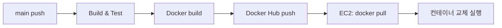

# 인프라 구성 상세

[← README로 돌아가기](../README.md)

## 목차
- [VPC · Subnet](#vpc--subnet)
- [보안 그룹](#보안-그룹)
- [IAM](#iam)
- [Parameter Store](#parameter-store)
- [S3](#s3)
- [Docker](#docker)
- [CI/CD](#cicd)
- [ALB · ASG · 도메인](#alb--asg--도메인)
- [CloudFront](#cloudfront)

리전: `ap-northeast-2` (서울)

---

## VPC · Subnet

| 리소스 | 이름 | CIDR | AZ | 라우팅 |
|---|---|---|---|---|
| VPC | `my-vpc` | `10.0.0.0/16` | | |
| Public Subnet 1 | `my-subnet-public1-ap-northeast-2a` | `10.0.0.0/20` | 2a | `my-rtb-public`: `0.0.0.0/0 → IGW(my-igw)` |
| Public Subnet 2 | `my-subnet-public2-ap-northeast-2b` | `10.0.16.0/20` | 2b | `my-rtb-public`: `0.0.0.0/0 → IGW(my-igw)` |
| Private Subnet 1 | `my-subnet-private1-ap-northeast-2a` | `10.0.128.0/20` | 2a | `my-rtb-private1-ap-northeast-2a`: `0.0.0.0/0 → NAT`, S3 → VPC 엔드포인트 |
| Private Subnet 2 | `my-subnet-private2-ap-northeast-2b` | `10.0.144.0/20` | 2b | `my-rtb-private2-ap-northeast-2b`: `0.0.0.0/0 → NAT`, S3 → VPC 엔드포인트 |

### 리소스 배치

| 리소스 | 이름 | 위치 | 외부 접근 |
|---|---|---|---|
| EC2 | `private-ec2` (t4g.small) | Private Subnet 1 | 공인 IP 없음 → 로컬에서 직접 접속 불가 |
| RDS | `my-database-private` (MySQL, db.t4g.micro) | DB 서브넷 그룹 `my-vpc-private-subnet-group` (Private 1·2) | 퍼블릭 액세스 `아니요` → 엔드포인트가 사설 IP(`10.0.x.x`)로만 조회됨 |
| NAT Gateway | `ci-demo-nat-gateway` (regional) | | Private 서브넷에서 외부로 **나가는** 통신(Docker Hub, SSM, Parameter Store) 전용 |

- EC2 접속은 SSH(22) 대신 **Session Manager**를 사용합니다. SSM 에이전트가 EC2 안에서 바깥으로 연결을 열기 때문에 인바운드 포트와 공인 IP가 필요 없습니다.
- 기존 Public Subnet의 EC2 · RDS는 AMI · 스냅샷(`my-database-before-private`)으로 복제해 Private Subnet에 새로 구성한 뒤 삭제했습니다.

## 보안 그룹

| 보안 그룹 | 인바운드 포트 | 소스 | 이유 |
|---|---|---|---|
| EC2 (`test-ec2-sg`) | 8080 | `0.0.0.0/0` | API · Actuator 접근 (ALB 구성 시 ALB 보안 그룹으로 좁힐 예정) |
| RDS (`test-rds-sg`) | 3306 | **EC2 보안 그룹 ID** (`test-ec2-sg`) | 보안 그룹 체이닝: EC2에서 오는 연결만 허용 |

- EC2의 22(SSH)는 Session Manager로 대체해 닫았고, 3306 · 80은 EC2가 받을 일이 없는 포트라 닫았습니다.

## IAM

EC2에 연결한 Role: `instanceRole`

애플리케이션 코드가 사용하는 AWS 작업:

| 서비스 | 작업 | 사용 위치 |
|---|---|---|
| SSM Parameter Store | 경로(`/camp-health-app/prod/`) 아래 파라미터 조회 | `spring.config.import` (prod) |
| S3 | `PutObject` | 프로필 이미지 업로드 |
| S3 | `DeleteObject` | 새 이미지 업로드 시 기존 이미지 삭제 |
| S3 | `GetObject` | Presigned URL로 이미지 조회 |

<details>
<summary>연결한 정책</summary>

AWS 관리형: `AmazonSSMManagedInstanceCore`(Session Manager), `AmazonSSMReadOnlyAccess`(Parameter Store 조회), `CloudWatchAgentServerPolicy`

고객 관리형 `S3CampHealthPolicy`:

```json
{
  "Version": "2012-10-17",
  "Statement": [
    {
      "Effect": "Allow",
      "Action": ["s3:PutObject", "s3:GetObject", "s3:DeleteObject"],
      "Resource": "arn:aws:s3:::camp-health-kde-files/uploads/*"
    }
  ]
}
```
</details>

## Parameter Store

경로: `/camp-health-app/prod/`

| Key | 용도 | 타입 |
|---|---|---|
| `DB_URL` | RDS 접속 URL → `spring.datasource.url` | |
| `DB_USERNAME` | DB 사용자 → `spring.datasource.username` | |
| `DB_PASSWORD` | DB 비밀번호 → `spring.datasource.password` | |
| `TEAM_NAME` | 확인용 파라미터 → `/actuator/info` | |

```yaml
# application-prod.yaml
spring:
  datasource:
    url: ${DB_URL}
    username: ${DB_USERNAME}
    password: ${DB_PASSWORD}
  config:
    import:
      - aws-parameterstore:/camp-health-app/prod/
  cloud:
    aws:
      parameterstore:
        enabled: true

management:
  info:
    env:
      enabled: true   # info.* 속성을 /actuator/info에 노출

info:
  app:
    message: ${TEAM_NAME}
```

`/actuator/info` 응답 형태:
```json
{ "app": { "message": "{TEAM_NAME 값}" } }
```

> local 프로필에서는 `spring.cloud.aws.parameterstore.enabled: false`로 Parameter Store를 사용하지 않습니다.

## S3

| 항목 | 설정 |
|---|---|
| 버킷 | `camp-health-kde-files` |
| 모든 퍼블릭 액세스 차단 | ON |
| 객체 key 규칙 | `uploads/members/{UUID}.{확장자}` |
| 업로드 제한 | PNG · JPEG · WebP, 최대 10MB |
| 조회 방식 | DB에 저장한 key로 Presigned URL(GET, 7일) 생성 |

## Docker

```dockerfile
FROM amazoncorretto:17-al2023-headless
WORKDIR /app
COPY build/libs/*.jar app.jar
EXPOSE 8080
ENTRYPOINT ["java", "-jar", "app.jar"]
```

- 빌드된 jar를 복사해 실행하는 구조이므로, 이미지 빌드 전에 `./gradlew bootJar`가 먼저 실행되어야 합니다.

## CI/CD



| GitHub Secret | 용도 |
|---|---|
| | |

## ALB · ASG · 도메인

| 항목 | 설정 |
|---|---|
| NAT Gateway | `ci-demo-nat-gateway` (regional, 2a·2b) |
| ALB 리스너 | |
| Target Group | |
| Launch Template | |
| ASG | |
| ACM 인증서 | |
| Route 53 | |

## CloudFront

| 항목 | 설정 |
|---|---|
| Origin | |
| 접근 제어 | |
| 이미지 URL 형식 | |
