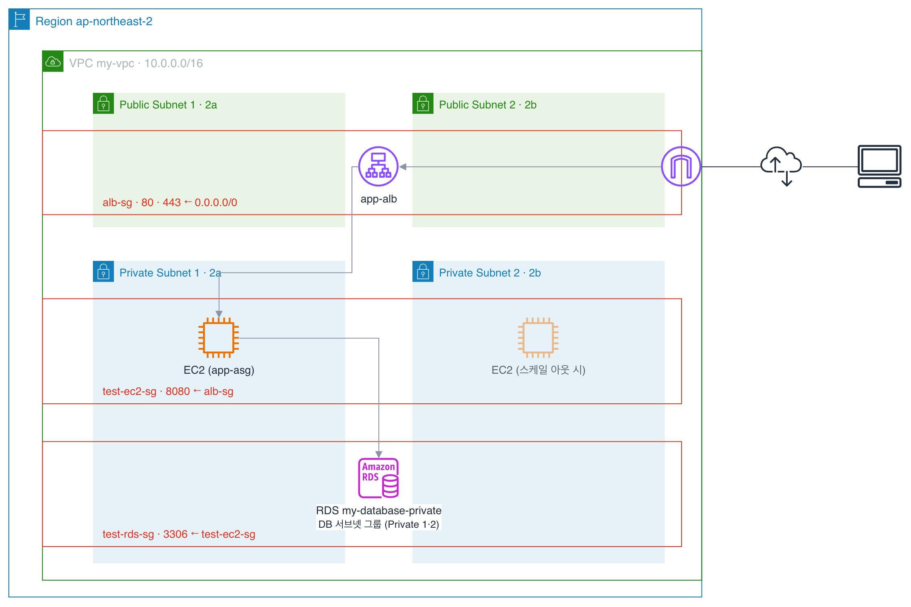
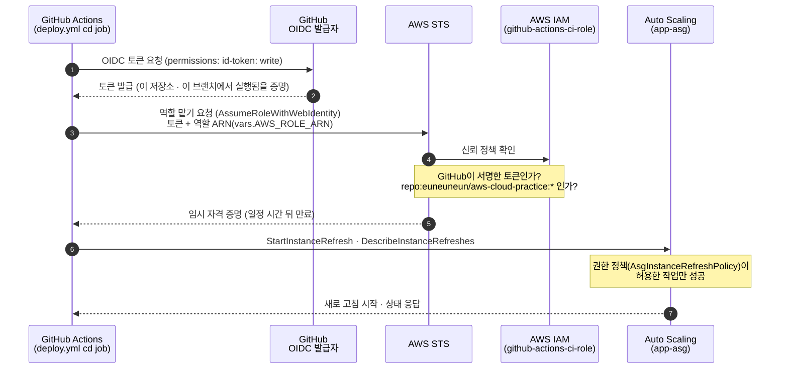
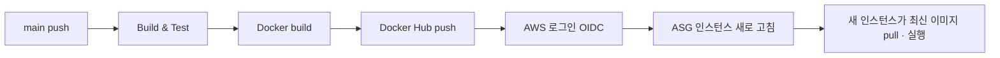
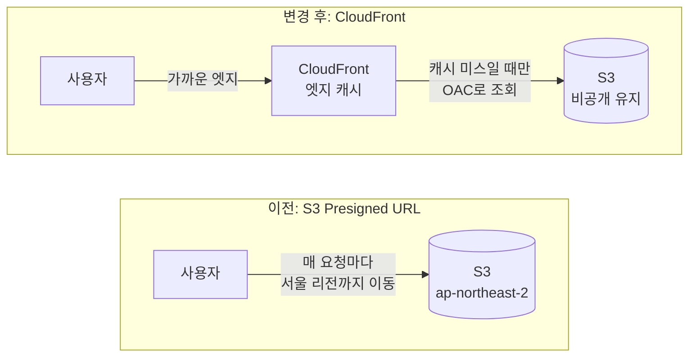

# 인프라 구성 상세

[← README로 돌아가기](../README.md)

## 목차
- [VPC · Subnet](#vpc--subnet)
- [보안 그룹](#보안-그룹)
- [IAM](#iam)
- [Parameter Store](#parameter-store)
- [S3](#s3)
- [Docker](#docker)
- [CI/CD](#cicd)
- [ALB · ASG · 도메인](#alb--asg--도메인)
- [CloudFront](#cloudfront)

리전: `ap-northeast-2` (서울)

## VPC · Subnet

<details>
<summary>용어 설명</summary>

리소스(Resource)는 AWS에서 만들어 쓰는 구성 요소 하나하나(EC2, RDS, S3 버킷, 보안 그룹 등)를 말한다.

| 용어 | 설명 |
|---|---|
| VPC | AWS 안에 만든 나만의 가상 네트워크. 이 안에 서버와 DB를 둔다. |
| CIDR | IP 범위를 표기하는 방법. `/` 뒤 숫자가 작을수록 범위가 넓다. (`10.0.0.0/16` = IP 약 6.5만 개, `/20` = 약 4천 개) |
| AZ (가용 영역) | 한 리전 안에서 물리적으로 떨어진 데이터센터. 2a · 2b처럼 두 곳에 나눠 두면 한 곳에 장애가 나도 서비스가 유지된다. |
| Subnet | VPC를 잘게 나눈 네트워크 구역. 하나의 AZ에 속한다. |
| Public Subnet | 인터넷과 직접 통신할 수 있는 서브넷. 외부 요청을 받는 ALB를 둔다. |
| Private Subnet | 인터넷에서 직접 들어올 수 없는 서브넷. EC2 · RDS를 둔다. |
| 라우팅 테이블 | 서브넷에서 나가는 트래픽을 어디로 보낼지 정한 표. 연결된 경로에 따라 Public / Private이 결정된다. |
| IGW (인터넷 게이트웨이) | VPC와 인터넷을 잇는 출입구. Public Subnet의 라우팅이 여기로 향한다. |
| NAT Gateway | Private Subnet에서 **밖으로 나가는 통신만** 가능하게 해 주는 장치. 밖에서 먼저 들어오는 연결은 막는다. |
| VPC 엔드포인트 | 인터넷이나 NAT를 거치지 않고 VPC 안에서 바로 AWS 서비스(S3)로 가는 통로 |

---

</details>


| 리소스 | 이름 | CIDR | AZ | 라우팅 |
|---|---|---|---|---|
| VPC | `my-vpc` | `10.0.0.0/16` | | |
| Public Subnet 1 | `my-subnet-public1-ap-northeast-2a` | `10.0.0.0/20` | 2a | `my-rtb-public`: `0.0.0.0/0 → IGW(my-igw)` |
| Public Subnet 2 | `my-subnet-public2-ap-northeast-2b` | `10.0.16.0/20` | 2b | `my-rtb-public`: `0.0.0.0/0 → IGW(my-igw)` |
| Private Subnet 1 | `my-subnet-private1-ap-northeast-2a` | `10.0.128.0/20` | 2a | `my-rtb-private1-ap-northeast-2a`: `0.0.0.0/0 → NAT`, S3 → VPC 엔드포인트 |
| Private Subnet 2 | `my-subnet-private2-ap-northeast-2b` | `10.0.144.0/20` | 2b | `my-rtb-private2-ap-northeast-2b`: `0.0.0.0/0 → NAT`, S3 → VPC 엔드포인트 |

### 리소스 배치

> 요청 흐름과 CI/CD까지 포함한 전체 구조는 [README의 아키텍처 그림](../README.md#architecture)을 참고한다.

| 리소스 | 이름 | 위치 | 외부 접근 |
|---|---|---|---|
| ALB | `app-alb` (internet-facing) | Public Subnet 1·2 | 외부 요청을 받는 유일한 입구 (HTTPS 443, HTTP 80은 HTTPS로 리다이렉트) |
| EC2 | ASG `app-asg`가 관리 (t4g.small, 1~2대) | Private Subnet 1·2 | 공인 IP가 없어 로컬에서 직접 접속할 수 없음 |
| RDS | `my-database-private` (MySQL, db.t4g.micro) | DB 서브넷 그룹 `my-vpc-private-subnet-group` (Private 1·2) | 퍼블릭 액세스가 `아니요`라 엔드포인트가 사설 IP(`10.0.x.x`)로만 조회됨 |
| NAT Gateway | `ci-demo-nat-gateway` (regional) | | Private 서브넷에서 외부로 나가는 통신(Docker Hub, SSM, Parameter Store) 전용 |
| CloudFront | `camp-health-images` | 글로벌 엣지 | 프로필 이미지 조회의 유일한 입구 (HTTPS) |
| S3 | `camp-health-kde-files` | 리전 서비스 (VPC 밖) | 퍼블릭 액세스 차단 · S3 URL 직접 요청은 403, CloudFront(OAC)만 읽기 가능 |

- EC2 접속은 SSH(22) 대신 Session Manager를 사용한다. SSM 에이전트가 EC2 안에서 바깥으로 연결을 열기 때문에 인바운드 포트와 공인 IP가 필요하지 않다.
- 기존 Public Subnet의 EC2 · RDS는 AMI · 스냅샷(`my-database-before-private`)으로 복제해 Private Subnet에 새로 구성한 뒤 삭제했다.

<details>
<summary>Session Manager란?</summary>

Session Manager는 SSH 없이 브라우저(AWS 콘솔)나 CLI에서 EC2에 접속하게 해 주는 AWS Systems Manager(SSM)의 기능이다.

**동작 원리**

```
EC2 안의 SSM 에이전트 ──(아웃바운드 443)──▶ AWS Systems Manager ◀── 나 (콘솔 / CLI)
```

1. EC2에서 실행 중인 SSM 에이전트가 AWS Systems Manager로 먼저 연결을 열어 둔다. (Amazon Linux 2023에는 기본 설치되어 있다.)
2. 콘솔에서 "연결"을 누르면, AWS가 이미 열려 있는 연결을 통해 명령을 전달한다.
3. 따라서 EC2에 들어오는(인바운드) 포트를 하나도 열 필요가 없다.

**SSH와 비교**

| | SSH | Session Manager |
|---|---|---|
| 연결 방향 | 내 컴퓨터 → EC2로 들어감 | EC2 → AWS로 먼저 나가서 연결을 열어 둠 |
| 필요한 것 | 22번 포트, 공인 IP(또는 배스천 서버), 키 파일(`.pem`) | EC2의 SSM 에이전트 + IAM 역할 |
| 인증 | 키 파일을 가진 사람 | IAM 권한이 있는 사람 |
| 접속 기록 | 따로 설정해야 함 | 누가 언제 접속했는지 CloudTrail에 기록됨 |

**이 프로젝트에서 동작하는 조건**

- **아웃바운드 경로**: EC2가 Private Subnet에 있어 공인 IP가 없지만, NAT Gateway로 밖에 나갈 수 있어 에이전트가 AWS에 연결할 수 있다.
- **IAM 권한**: `instanceRole`의 `AmazonSSMManagedInstanceCore` 정책이 에이전트와 Systems Manager의 통신을 허용한다. ([IAM](#iam) 참고)
- **결과**: 보안 그룹에서 22번 포트를 닫을 수 있었다. CPU 부하 테스트([Auto Scaling 동작](#auto-scaling-동작))도 Session Manager로 접속해 진행했다.

---

</details>

## 보안 그룹

<details>
<summary>보안 그룹이란?</summary>

보안 그룹(Security Group)은 EC2 · RDS · ALB 같은 리소스 하나하나에 붙는 가상 방화벽이다. 어떤 출발지에서 어떤 포트로 들어오고 나가는 트래픽을 허용할지 규칙으로 정한다.

**규칙 구성**

| 항목 | 설명 | 예시 |
|---|---|---|
| 방향 | 인바운드(들어오는 트래픽) / 아웃바운드(나가는 트래픽) | 인바운드 |
| 프로토콜 · 포트 | 허용할 통신 종류와 포트 번호 | TCP 8080 |
| 소스(인바운드) / 대상(아웃바운드) | 트래픽을 보내는 쪽 또는 받는 쪽. IP 범위(CIDR)나 다른 보안 그룹으로 지정한다. | `0.0.0.0/0`, `alb-sg` |

**소스와 대상**

소스(Source)는 인바운드 규칙에서 **트래픽이 어디에서 오는지(출발지)** 정하는 칸이다. 아웃바운드 규칙에서는 같은 자리를 대상(Destination)이라 부르며, **트래픽이 어디로 나가는지(목적지)** 정한다.

규칙 하나는 "**소스**에서 오는 트래픽만 **포트**로 들어올 수 있다"로 읽는다. 예를 들어 EC2의 `8080 / alb-sg` 규칙은 "`alb-sg`에서 오는 트래픽만 8080 포트로 들어올 수 있다"는 뜻이다.

| 소스 종류 | 예시 | 의미 |
|---|---|---|
| 모든 IP | `0.0.0.0/0` | 인터넷의 누구나 |
| IP 하나 | `203.0.113.5/32` | 이 IP에서 오는 트래픽만 (`/32` = IP 1개) |
| IP 범위 | `10.0.0.0/16` | 이 범위에 속한 IP들 (예: VPC 내부 전체) |
| 다른 보안 그룹 | `alb-sg` | 이 보안 그룹이 붙은 리소스에서 오는 트래픽만 |

이 프로젝트의 소스 설정:
- ALB: `0.0.0.0/0`. 사용자가 어디서든 접속해야 하므로 모든 IP를 허용한다. `0.0.0.0/0`은 인터넷의 입구인 ALB에만 사용한다.
- EC2: `alb-sg`. ALB만 EC2에 접근할 수 있고, 인터넷에서 EC2로 바로 들어오는 트래픽은 막힌다.
- RDS: `test-ec2-sg`. EC2만 DB에 접속할 수 있다.
- 아웃바운드 대상: ALB · EC2는 기본값 `0.0.0.0/0`(어디로든 나갈 수 있음)이고, RDS는 아웃바운드 규칙이 없다. RDS는 먼저 연결을 시작할 일이 없고, EC2 요청에 대한 응답은 상태 저장(Stateful) 특성으로 자동 허용되므로 규칙이 없어도 동작한다.

**동작 방식**

- **허용 규칙만 있다**: "이 트래픽은 막아라"라는 거부 규칙은 없다. 규칙에 적힌 트래픽만 통과하고, 나머지는 모두 막힌다.
- **기본값**: 새로 만든 보안 그룹은 인바운드 규칙이 없어 들어오는 트래픽을 모두 막고, 아웃바운드는 모두 허용한다.
- **상태 저장(Stateful)**: 허용된 요청에 대한 **응답은 규칙과 상관없이 자동으로 통과**한다. 예를 들어 EC2가 RDS에 3306으로 요청하면, RDS의 응답이 EC2로 돌아올 때 EC2 보안 그룹에 별도 인바운드 규칙이 필요 없다.
- **즉시 적용**: 규칙을 바꾸면 서버를 재시작하지 않아도 바로 반영된다.
- **여러 개 연결 가능**: 리소스 하나에 보안 그룹을 여러 개 붙이면, 모든 그룹의 허용 규칙을 합친 만큼 허용된다.

**보안 그룹 체이닝**

소스에 IP 대신 **다른 보안 그룹**을 지정하는 방식이다. 이 프로젝트의 API 요청은 아래 순서로 보안 그룹을 통과한다.

1. 사용자 → ALB: `alb-sg`가 모든 IP(`0.0.0.0/0`)의 443을 허용한다.
2. ALB → EC2: `test-ec2-sg`가 **`alb-sg`가 붙은 리소스에서 온** 8080만 허용한다. 인터넷에서 EC2로 바로 들어오는 요청은 막힌다.
3. EC2 → RDS: `test-rds-sg`가 **`test-ec2-sg`가 붙은 리소스에서 온** 3306만 허용한다. EC2가 아닌 곳에서는 DB에 접속할 수 없다.

IP로 지정하면 ASG가 서버를 새로 만들 때마다 IP가 바뀌어 규칙을 고쳐야 한다. 보안 그룹으로 지정하면 새 서버에도 같은 보안 그룹이 붙으므로 규칙을 고칠 필요가 없다.
---

</details>




```
[API]    인터넷 ──443(80→443)──▶ ALB ──8080──▶ EC2 ──3306──▶ RDS
              누구나        ALB만          EC2만

[이미지] 인터넷 ──443──▶ CloudFront ──OAC──▶ S3 (비공개)
                                  이 배포만
```

- 이미지 경로는 VPC 밖이라 보안 그룹이 아닌 S3 버킷 정책(OAC)으로 접근을 제한한다. ([CloudFront](#cloudfront) 참고).

| 보안 그룹 | 인바운드 포트 | 소스 | 이유 |
|---|---|---|---|
| ALB (`alb-sg`) | 80 · 443 | `0.0.0.0/0` | 인터넷에서 오는 요청을 받는 입구 (80은 HTTPS 리다이렉트용) |
| EC2 (`test-ec2-sg`) | 8080 | ALB 보안 그룹 ID (`alb-sg`) | 보안 그룹 체이닝: ALB가 전달한 요청만 허용 |
| RDS (`test-rds-sg`) | 3306 | EC2 보안 그룹 ID (`test-ec2-sg`) | 보안 그룹 체이닝: EC2에서 오는 연결만 허용 |

- 소스를 IP가 아닌 보안 그룹으로 지정해, ALB · EC2의 IP가 바뀌거나 늘어나도 규칙을 고칠 필요가 없다.
- EC2의 22번(SSH) 포트는 Session Manager 접속 방식으로 전환하며 폐쇄했고, EC2가 직접 트래픽을 수신할 일이 없는 3306과 80번 포트 역시 차단하여 불필요한 포트 노출을 최소화했다.

## IAM

<details>
<summary>IAM이란?</summary>

IAM(Identity and Access Management)은 **누가(주체) 어떤 AWS 리소스에 무엇을 할 수 있는지(권한)** 정하는 AWS 서비스다. AWS의 모든 API 요청은 IAM을 거쳐 허용 여부가 결정된다. 콘솔 클릭, CLI 명령, 애플리케이션의 SDK 호출 모두 마찬가지다.

**1. 주체: 누가 요청하는가**

| 주체 | 설명 | 로그인 방법 | 예시 |
|---|---|---|---|
| 루트 계정 | AWS 가입 시 만든 계정. **모든 권한**을 가지며 제한할 수 없다. | 이메일 + 비밀번호 | 결제, 계정 해지 같은 일부 작업에만 사용 |
| IAM 사용자 | 사람이나 프로그램에 발급하는 **영구 계정** | 콘솔 비밀번호 또는 액세스 키 | 콘솔에 로그인하는 개발자 |
| IAM 그룹 | 사용자를 묶어 권한을 한 번에 주는 단위. 그룹 자체로는 로그인할 수 없다. | - | `developers` 그룹 |
| IAM 역할(Role) | 필요할 때 **잠시 맡아서 쓰는 권한**. 영구 키가 없고, 역할을 맡으면 임시 자격 증명이 발급된다. | 역할 맡기(AssumeRole) | EC2, GitHub Actions |

- **사용자 vs 역할**: 사용자의 액세스 키는 직접 지우기 전까지 계속 유효해서, 코드나 서버에 저장했다가 유출되면 위험하다. 역할의 임시 자격 증명은 일정 시간이 지나면 만료되고 자동으로 새로 발급되므로, 저장하거나 관리할 키가 없다.
- **루트 계정은 평소에 쓰지 않는다**: 유출되면 계정 전체가 위험하므로 MFA를 걸어 두고, 일상 작업은 IAM 사용자나 역할로 한다.

**2. 정책: 무엇을 허용하는가**

정책은 허용하거나 거부할 작업을 적은 JSON 문서다. 주체에 붙여서 권한을 준다.

```jsonc
{
  "Effect": "Allow",                                         // 허용(Allow) 또는 거부(Deny)
  "Action": ["s3:PutObject"],                                // 어떤 작업을
  "Resource": "arn:aws:s3:::camp-health-kde-files/uploads/*" // 어떤 리소스에 대해
}
```

| 정책 종류 | 설명 | 이 프로젝트 예시 |
|---|---|---|
| AWS 관리형 | AWS가 만들어 둔 정책. 여러 곳에 재사용한다. | `AmazonSSMManagedInstanceCore` |
| 고객 관리형 | 직접 만든 정책. 여러 곳에 재사용할 수 있다. | `S3CampHealthPolicy` |
| 인라인 | 역할 하나에만 직접 넣은 정책. 다른 곳에 재사용할 수 없다. | `AsgInstanceRefreshPolicy` |

**3. 권한 판단 순서**

1. 기본값은 **모두 거부**다. 아무 정책도 없으면 아무것도 할 수 없다.
2. 붙어 있는 정책 중 하나라도 `Allow`하면 허용된다.
3. 단, 어느 정책에든 `Deny`가 있으면 `Allow`가 있어도 **거부가 이긴다.**

**4. 역할은 어떻게 동작하나**

역할에는 정책이 두 종류 붙는다.

| | 신뢰 정책 (Trust Policy) | 권한 정책 (Permission Policy) |
|---|---|---|
| 정하는 것 | **누가** 이 역할을 맡을 수 있는지 | 역할을 맡은 뒤 **무엇을** 할 수 있는지 |
| `instanceRole` | EC2 서비스 | S3 업로드 · 삭제, Parameter Store 조회 등 |
| `github-actions-ci-role` | GitHub OIDC 중 `repo:euneuneun/aws-cloud-practice:*` | ASG 인스턴스 새로 고침 |

- **EC2 (`instanceRole`)**: 인스턴스에 역할을 연결하면 EC2 안에서 임시 자격 증명을 받을 수 있다. 애플리케이션의 AWS SDK(Spring Cloud AWS)가 이를 자동으로 찾아 쓰므로, 코드나 설정 파일에 액세스 키를 넣을 필요가 없다.
- **GitHub Actions (`github-actions-ci-role`)**: OIDC 방식을 쓴다.
  1. GitHub이 워크플로우 실행마다 "이 요청은 이 저장소에서 왔다"는 토큰을 발급한다(`permissions: id-token: write`).
  2. AWS가 토큰을 확인하고, 신뢰 정책의 저장소 조건과 맞으면 임시 자격 증명을 내준다.
  3. 그래서 GitHub Secrets에 AWS 액세스 키를 저장하지 않아도 되고, 다른 저장소는 이 역할을 맡을 수 없다.



- 1~5는 `aws-actions/configure-aws-credentials` 액션이 자동으로 처리하고, 6부터 배포 스크립트가 받은 임시 자격 증명으로 AWS를 호출한다.
- 신뢰 정책(4)은 **누가 역할을 맡을 수 있는지**, 권한 정책(6)은 **맡은 뒤 무엇을 할 수 있는지**를 검사한다.

**5. 최소 권한 원칙**

필요한 작업만, 필요한 리소스에만 허용한다. 권한이 넓을수록 자격 증명이 유출되거나 코드에 버그가 있을 때 피해 범위가 커진다.

- `instanceRole`의 S3 권한은 모든 버킷이 아니라 `camp-health-kde-files/uploads/*` 경로에만 적용된다.
- `github-actions-ci-role`은 배포에 필요한 `app-asg`의 새로 고침 시작 · 조회만 할 수 있다.

---

</details>

| Role | 사용 주체 | 연결한 정책 |
|---|---|---|
| `instanceRole` | EC2 (ASG 인스턴스) | 아래 참고 |
| `github-actions-ci-role` | GitHub Actions (OIDC, `repo:euneuneun/aws-cloud-practice:*`만 허용) | 인라인 `AsgInstanceRefreshPolicy`: `app-asg`에 대한 `StartInstanceRefresh` · `DescribeInstanceRefreshes` |

`instanceRole`은 애플리케이션 코드가 쓰는 아래 AWS 작업을 허용한다.

| 서비스 | 작업 | 사용 위치 |
|---|---|---|
| SSM Parameter Store | 경로(`/camp-health-app/prod/`) 아래 파라미터 조회 | `spring.config.import` (prod) |
| S3 | `PutObject` | 프로필 이미지 업로드 |
| S3 | `DeleteObject` | 새 이미지 업로드 시 기존 이미지 삭제 |
| S3 | `GetObject` | 사용 안 함 (CloudFront 전환 후 이미지 조회는 CloudFront가 OAC로 처리) |

<details>
<summary>연결한 정책</summary>

AWS 관리형: `AmazonSSMManagedInstanceCore`(Session Manager), `AmazonSSMReadOnlyAccess`(Parameter Store 조회), `CloudWatchAgentServerPolicy`

고객 관리형 `S3CampHealthPolicy`:

```json
{
  "Version": "2012-10-17",
  "Statement": [
    {
      "Effect": "Allow",
      "Action": ["s3:PutObject", "s3:GetObject", "s3:DeleteObject"],
      "Resource": "arn:aws:s3:::camp-health-kde-files/uploads/*"
    }
  ]
}
```

---

</details>

## Parameter Store

경로: `/camp-health-app/prod/`

| Key | 용도 | 타입 |
|---|---|---|
| `DB_URL` | RDS 접속 URL → `spring.datasource.url` | `String` |
| `DB_USERNAME` | DB 사용자 → `spring.datasource.username` | `String` |
| `DB_PASSWORD` | DB 비밀번호 → `spring.datasource.password` | `String` |
| `TEAM_NAME` | 확인용 파라미터 → `/actuator/info` | `String` |

```yaml
# application-prod.yaml
spring:
  datasource:
    url: ${DB_URL}
    username: ${DB_USERNAME}
    password: ${DB_PASSWORD}
  config:
    import:
      - aws-parameterstore:/camp-health-app/prod/
  cloud:
    aws:
      parameterstore:
        enabled: true

management:
  info:
    env:
      enabled: true   # info.* 속성을 /actuator/info에 노출

info:
  app:
    message: ${TEAM_NAME}
```

`/actuator/info` 응답 형태:
```json
{ "app": { "message": "{TEAM_NAME 값}" } }
```

> local 프로필에서는 `spring.cloud.aws.parameterstore.enabled: false`로 Parameter Store를 사용하지 않는다.

## S3

| 항목 | 설정 |
|---|---|
| 버킷 | `camp-health-kde-files` |
| 모든 퍼블릭 액세스 차단 | ON |
| 객체 key 규칙 | `uploads/members/{UUID}.{확장자}` |
| 업로드 제한 | PNG · JPEG · WebP, 최대 10MB |
| 조회 방식 | DB에 저장한 key로 CloudFront URL 생성 ([CloudFront](#cloudfront) 참고) |

## Docker

```dockerfile
FROM amazoncorretto:17-al2023-headless
WORKDIR /app
COPY build/libs/*.jar app.jar
EXPOSE 8080
ENTRYPOINT ["java", "-jar", "app.jar"]
```

- 빌드된 jar를 복사해 실행하는 구조이므로, 이미지 빌드 전에 `./gradlew bootJar`가 먼저 실행되어야 한다.

## CI/CD



- EC2가 Private Subnet에 있어 SSH로 접속할 수 없으므로, ASG에 인스턴스 새로 고침을 요청해 서버를 교체하는 방식으로 배포한다.
- 새 인스턴스는 시작 템플릿(EC2를 만들 때 쓰는 설계도)의 사용자 데이터로 Docker Hub의 최신 이미지를 받아 실행한다.
- `MinHealthyPercentage 100` · `MaxHealthyPercentage 200`: 새 인스턴스가 healthy가 된 뒤 기존 인스턴스를 종료해 배포 중에도 서비스가 끊기지 않는다.
- 교체가 끝날 때까지 30초마다 상태를 확인하고(최대 20분), 결과를 Discord로 알린다.
- `concurrency: deploy`로 배포는 한 번에 하나씩만 실행된다. 새로 고침이 진행 중일 때 또 merge되면, 다음 배포는 취소되지 않고 앞 배포가 끝날 때까지 기다린다. (동시에 요청하면 `InstanceRefreshInProgress` 오류로 실패하기 때문)

| GitHub Secret / Variable | 용도 |
|---|---|
| `DOCKERHUB_USERNAME` (Variable) | Docker Hub 계정 · 이미지 이름 |
| `DOCKERHUB_TOKEN` | Docker Hub 로그인 |
| `AWS_ROLE_ARN` · `AWS_REGION` (Variable) | OIDC로 맡을 IAM 역할 · 리전 |
| `DISCORD_CI_WEBHOOK_URL` · `DISCORD_DEPLOY_WEBHOOK_URL` | CI · 배포 결과 알림 |

## ALB · ASG · 도메인

<details>
<summary>ALB · ASG · 도메인이란?</summary>

**전체 요청 흐름**

```
사용자 ──https://api.ked-aws.click──▶ Route 53 (도메인 → ALB 주소 변환)
       ──443──▶ ALB (HTTPS 해제, ACM 인증서) ──8080──▶ Target Group ──▶ EC2 (ASG가 관리)
```

1. 사용자가 `api.ked-aws.click`에 접속하면, Route 53이 이 도메인을 ALB 주소로 알려 준다.
2. ALB가 HTTPS 요청을 받아 ACM 인증서로 암호화를 풀고, Target Group에 등록된 정상 EC2 중 하나로 전달한다.
3. EC2는 ASG가 관리한다. 서버가 고장 나면 새로 만들고, 부하에 따라 개수를 늘리거나 줄인다.

**ALB (Application Load Balancer)**

여러 서버 앞에서 요청을 받아 나눠 주는 **로드밸런서**다. 사용자는 서버가 몇 대인지 몰라도 ALB 주소 하나로 접속한다.

| 구성 요소 | 설명 | 이 프로젝트 |
|---|---|---|
| 리스너 | ALB가 요청을 기다리는 포트와, 받은 요청을 어떻게 처리할지 정한 규칙 | `443` → `app-tg`로 전달, `80` → `443`으로 리다이렉트 |
| Target Group | 요청을 받을 서버 목록. ALB는 이 목록의 **정상(healthy) 서버에만** 요청을 보낸다. | `app-tg` (EC2의 8080) |
| 헬스체크 | Target Group이 주기적으로 서버에 요청을 보내 살아 있는지 확인하는 기능. 응답이 없거나 실패하면 그 서버로 요청을 보내지 않는다. | `GET /actuator/health` |

- **TLS 종료**: HTTPS 암호화는 ALB에서 풀고, ALB → EC2 구간은 VPC 내부라 HTTP로 보낸다. 인증서를 서버마다 설치할 필요 없이 ALB 한 곳에서만 관리하면 된다.
- **서브넷 2개 필요**: ALB는 최소 2개의 AZ에 걸쳐 만들어야 한다. 한 AZ에 장애가 나도 다른 AZ에서 요청을 받을 수 있다.

**시작 템플릿 (Launch Template)**

EC2를 만들 때 쓰는 설계도이다. AMI(운영체제), 인스턴스 유형, 보안 그룹, IAM 역할, 사용자 데이터(처음 켜질 때 실행할 스크립트)를 미리 정해 둔다. ASG는 서버가 필요할 때마다 이 설계도대로 EC2를 만든다.

**ASG (Auto Scaling Group)**

같은 설계도로 만든 EC2 묶음을 정해진 개수만큼 자동으로 유지하는 기능이다.

| 설정 | 의미 | 이 프로젝트 |
|---|---|---|
| 원하는 용량 | 지금 유지할 서버 수. 스케일링 정책이 이 값을 바꾼다. | 1 |
| 최소 / 최대 | 원하는 용량이 움직일 수 있는 범위 | 1 / 2 |
| 상태 확인 유형 | 서버가 고장 났는지 판단하는 기준 | EC2 + ELB |
| 상태 확인 유예 기간 | 새 서버가 켜진 뒤 상태 확인을 시작하기까지 기다리는 시간 | 300초 |
| 스케일링 정책 | 서버 수를 늘리고 줄이는 조건 | 평균 CPU 50% 유지 (대상 추적) |

- **상태 확인 EC2 + ELB**: EC2 확인만 쓰면 서버 자체가 꺼졌을 때만 고장으로 본다. ELB 확인을 함께 켜면, 서버는 켜져 있어도 **앱이 응답하지 않을 때**(헬스체크 실패) 고장으로 보고 새 서버로 교체한다.
- **유예 기간 300초**: 새 서버는 Docker 설치, 이미지 다운로드, Spring Boot 시작까지 시간이 걸린다. 그 사이에 헬스체크가 실패해 서버가 교체되는 일을 막는다.
- **대상 추적 정책**: "평균 CPU를 50%로 유지하라"는 목표만 정하면, AWS가 CloudWatch 알람을 만들어 서버 수를 알아서 조절한다. ([Auto Scaling 동작](#auto-scaling-동작) 참고)

**ACM (AWS Certificate Manager)**

HTTPS에 필요한 **SSL/TLS 인증서**를 발급하고 관리하는 서비스다. ALB에 붙여 쓰는 인증서는 무료다.

- **와일드카드 인증서**: `*.ked-aws.click`은 `api.ked-aws.click`처럼 한 단계 아래의 모든 서브도메인에 쓸 수 있다. 루트 도메인 `ked-aws.click`은 `*`에 포함되지 않아 함께 등록했다.
- **DNS 검증**: "이 도메인의 주인이 맞다"는 것을 Route 53에 CNAME 레코드를 추가해 증명한다. 이 레코드를 지우지 않으면 인증서가 만료 전에 자동으로 갱신된다.

**Route 53**

AWS의 DNS 서비스다. `api.ked-aws.click` 같은 도메인 이름을 실제 서버 주소로 바꿔 준다.

| 용어 | 설명 | 이 프로젝트 |
|---|---|---|
| 도메인 | 사람이 읽기 쉬운 인터넷 주소. 등록 기관에서 구매한다. | `ked-aws.click` (Route 53에서 구매) |
| 호스팅 영역 | 한 도메인의 DNS 레코드를 모아 둔 곳 | `ked-aws.click` |
| 레코드 | "이 이름은 이 주소로 가라"는 규칙 한 줄 | `api.ked-aws.click` → `app-alb` |

- **A 레코드(별칭)를 쓴 이유**: ALB는 고정 IP가 없고 IP가 수시로 바뀐다. 별칭(Alias) 레코드는 IP 대신 **ALB 자체를 가리키므로** IP가 바뀌어도 Route 53이 알아서 따라간다. AWS 리소스를 가리키는 별칭 레코드는 조회 요금도 없다.

- **CNAME과 별칭(Alias)의 차이**: CNAME은 루트 도메인(`ked-aws.click`)에 만들 수 없고 조회 요금이 붙는다. 별칭은 루트 도메인에도 만들 수 있고 AWS 리소스를 가리킬 때 무료다. 그래서 ALB를 가리킬 때는 별칭을 쓴다.
- NS · SOA는 호스팅 영역이 동작하는 데 필요한 레코드라 지우면 안 된다.

---

</details>

| 항목 | 설정 |
|---|---|
| NAT Gateway | `ci-demo-nat-gateway` (regional, 2a·2b) |
| ALB | `app-alb` · internet-facing · Public Subnet 1·2 · `alb-sg` |
| ALB 리스너 | `HTTPS:443` → `app-tg`로 전달 (보안 정책 `ELBSecurityPolicy-TLS13-1-2-Res-PQ-2025-09`)<br>`HTTP:80` → `HTTPS:443`으로 301 리다이렉트 |
| Target Group | `app-tg` · HTTP:8080 · 대상 유형 인스턴스 · 헬스체크 `/actuator/health` |
| Launch Template | `app-lt` · Amazon Linux 2023 (arm64) · `t4g.small` · `test-ec2-sg` · `instanceRole` · 사용자 데이터로 Docker 설치 후 Docker Hub 최신 이미지 실행 |
| ASG | `app-asg` · Private Subnet 1·2 · `app-tg` 연결 · 상태 확인 EC2 + ELB (유예 300초) · 원하는 1 / 최소 1 / 최대 2 · 대상 추적 정책 평균 CPU 50% |
| ACM 인증서 | 서울 리전 · `ked-aws.click` + `*.ked-aws.click` · DNS 검증 (Route 53 CNAME) · HTTPS 리스너에 적용 |
| Route 53 | 도메인 `ked-aws.click` (Route 53에서 구매) · 호스팅 영역 `ked-aws.click`<br>`api.ked-aws.click` A 레코드(별칭) → `app-alb` |

- HTTPS는 ALB에서 끝나고(TLS 종료), ALB → EC2 구간은 VPC 내부의 HTTP 8080으로 전달. EC2에는 인증서가 필요하지 않다.
- ALB에는 같은 리전(서울)의 ACM 인증서만 붙일 수 있다.

<details>
<summary>시작 템플릿 사용자 데이터</summary>

```bash
#!/bin/bash
set -e

# ── Docker 설치 ──
dnf update -y
dnf install -y docker
systemctl enable docker
systemctl start docker

# ── 앱 컨테이너 실행 ──
docker pull daeun123/aws-cloud-practice:latest
docker run -d -p 8080:8080 \
  --restart unless-stopped \
  --name app \
  -e SPRING_PROFILES_ACTIVE=prod \
  daeun123/aws-cloud-practice:latest
```

---

</details>

### Auto Scaling 동작

대상 추적 정책을 만들면 CloudWatch 알람 2개가 자동으로 생성되고, 이 알람이 원하는 용량을 바꾼다.

| CloudWatch 알람 | 조건 | 동작 |
|---|---|---|
| `TargetTracking-app-asg-AlarmHigh-…` | 평균 CPU > 50% · 1분 × 3회 연속 | 서버 늘림 (최대 2) |
| `TargetTracking-app-asg-AlarmLow-…` | 평균 CPU < 35% · 1분 × 15회 연속 | 서버 줄임 (최소 1) |

- 인스턴스 확장은 3분, 축소는 15분의 관찰 주기를 둔다. 부하가 일시적으로 감소했을 때 서버가 섣불리 종료되었다가 곧바로 재기동되는 병목과 비효율을 막기 위해서다.

CPU 부하 테스트 결과 (Session Manager에서 `yes > /dev/null`로 CPU 100% 유지):

| 시각 (KST) | 이벤트 |
|---|---|
| 11/20 23:09 | `AlarmHigh` → 원하는 용량 1 → 2, 인스턴스 1대 추가 생성 |
| 11/20 23:30 | 부하 프로세스 종료 |
| 11/20 23:47 | `AlarmLow` → 원하는 용량 2 → 1, 인스턴스 1대 자동 종료 |

## CloudFront

| 항목 | 설정 |
|---|---|
| 배포 | `camp-health-images` (`ECJ4VUCM5SQV2`) · 요금제 Free ($0/월) |
| 배포 도메인 | `d3hzsvsrcwxkah.cloudfront.net` |
| Origin | S3 `camp-health-kde-files.s3.ap-northeast-2.amazonaws.com` · 오리진 경로 없음 |
| 접근 제어 | OAC · 버킷 정책으로 이 배포(`AWS:SourceArn`)만 `s3:GetObject` 허용 · 버킷 퍼블릭 액세스 차단 유지 |
| 뷰어 프로토콜 | HTTP → HTTPS 리다이렉트 |
| 캐시 | S3용 권장 캐시 설정 (CachingOptimized) |
| 보안 | 보안 보호 활성화 · 모니터 모드 사용 안 함 (Free 요금제에 포함) |
| 이미지 URL 형식 | `https://d3hzsvsrcwxkah.cloudfront.net/{S3 key}` (예: `.../uploads/members/{UUID}.png`) |

```yaml
# application.yaml
cloudfront:
  domain: d3hzsvsrcwxkah.cloudfront.net
```

```java
// MemberService.getProfileImage: 오리진 경로가 비어 있어 URL 경로 = S3 key
String imageUrl = "https://" + cloudFrontDomain + "/" + key;
```

### S3 Presigned URL vs CloudFront



| 항목 | S3 Presigned URL (이전) | CloudFront (변경 후) |
|---|---|---|
| URL 형식 | `{버킷}.s3.ap-northeast-2.amazonaws.com/...?X-Amz-...` | `https://dxxxx.cloudfront.net/uploads/...` |
| 전달 경로 | 매번 서울 리전 S3에서 직접 전달 | 사용자와 가까운 엣지 캐시에서 전달, 캐시 미스일 때만 S3 조회 |
| 해외 사용자 응답 속도 | 거리만큼 느려짐 | 엣지에 캐시된 뒤에는 빠름 |
| S3 접근 제어 | 버킷 비공개 + 요청마다 서명 | 버킷 비공개 유지, OAC로 CloudFront만 읽기 허용 |
| 만료 | 7일 뒤 만료 → 다시 발급 필요 | 도메인 방식은 만료 없음 / Signed URL 방식은 직접 설정 |
| 같은 이미지 반복 조회 | 매번 S3 요청 · S3 전송 요금 | 엣지 캐시 응답 (S3 → CloudFront 구간 전송은 무료) |
