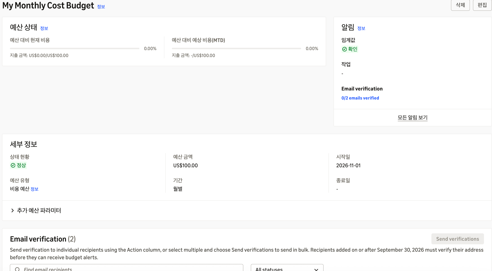
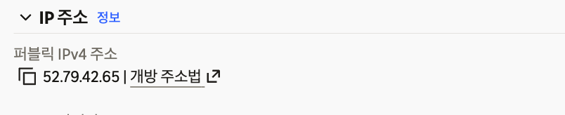
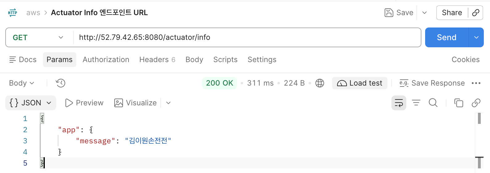
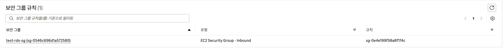
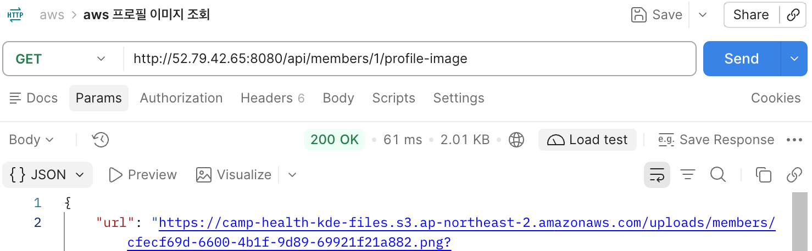
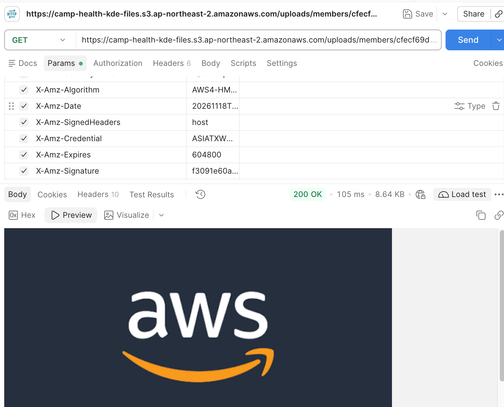
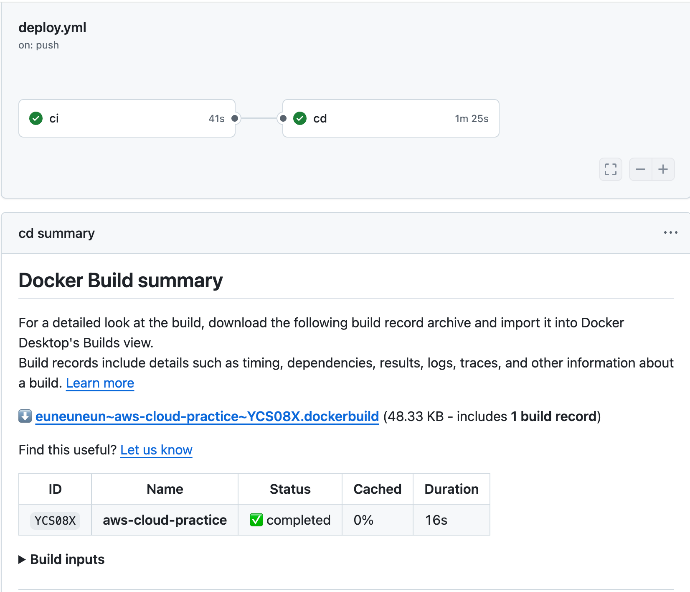
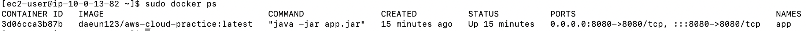

# 과제 제출물

[← README로 돌아가기](../../README.md)

| 레벨 | 항목 | 제출 |
|---|---|---|
| LV 0 | Budgets 캡처 | [보기](#lv0) |
| LV 1 | EC2 퍼블릭 IP | `52.79.42.65` · [캡처](#lv1) |
| LV 2 | Actuator Info URL | `http://52.79.42.65:8080/actuator/info` · [캡처](#lv2-1) |
| LV 2 | RDS 인바운드 규칙 캡처 | [보기](#lv2-2) |
| LV 3 | Presigned URL 접근 성공 (IAM Role) | [보기](#lv3) |
| LV 4 | Actions 성공 · `docker ps` 캡처 | [보기](#lv4) |
| LV 5 | HTTPS 도메인 · Target Group 캡처 | |
| LV 6 | CloudFront 이미지 URL | |

---

## LV 0 · AWS Budget 설정

## LV 1 · EC2 퍼블릭 IP

## LV 2-1 · Actuator Info 엔드포인트

## LV 2-2 · RDS 보안 그룹 인바운드 규칙 (소스 = EC2 보안 그룹 ID)

## LV 3 · Presigned URL 접근 성공 (IAM Role 사용)

> IAM Role의 임시 자격 증명으로 서명한 Presigned URL은 만료를 7일로 설정해도 자격 증명 세션이 끝나면 함께 만료되므로, 과제 안내에 따라 URL 대신 접근 성공 스크린샷을 첨부합니다.

**1) 서버에서 Presigned URL 발급**

**2) 발급된 URL로 S3 객체 접근 성공 (200 OK)**

## LV 4 · GitHub Actions / docker ps

## LV 5 · HTTPS 도메인 / Target Group

## LV 6 · CloudFront 이미지 URL
